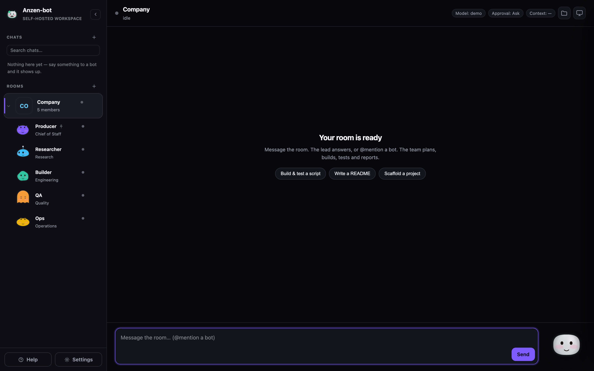
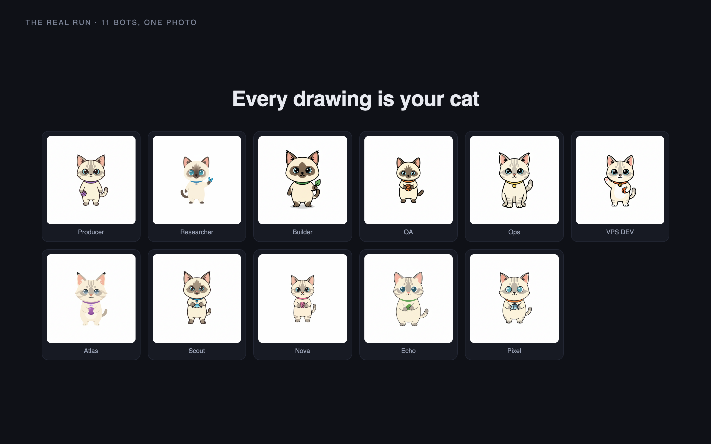
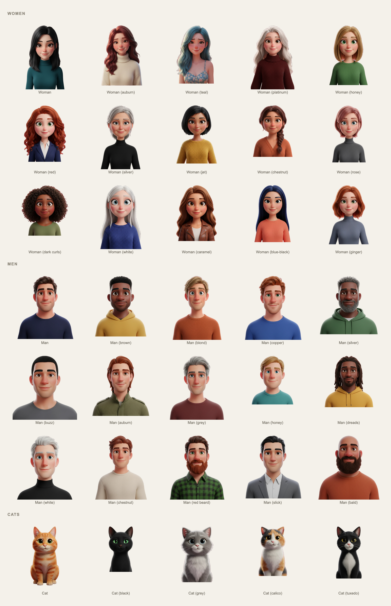

# 🚀 Anzen-bot

> A self-hosted multi-agent chat workspace where a team of AI bots plans, builds, tests and ships work on your own machine.


---

## 📷 Demo



*The default install: one room called Company, five bots already on the team.*

### Bot faces: one image → a whole team

[](docs/bot-faces.mp4)

*One photo in, one face per bot out — and every drawing is the same animal as the photo. [Watch the 52-second recording](docs/bot-faces.mp4).*

The prompt never names a species: it asks the model to redraw the subject and keep it. Telling it `Species: owl` drew a cat as an owl — [before and after, same photo and model](docs/bot-faces-why.png).

The drawing is the face, not the body: head and hair only, nothing drawn behind it, filling the bot's space. A face is a portrait, so it moves like one — it breathes from the chest, turns and tilts its head, and blinks, because each face comes with a second drawing of the same head with its eyes shut. It never bobs or bounces: translating a photograph up and down is not something anything alive does.

A bot's own **Face picture** in its editor is the other way to give it a face. Both are kept — picking a face from the set drops the picture, and introducing a picture drops the set's face — so whichever you chose last is the one you see.

### Bot faces: thirty-five characters already drawn



*The thirty-five shipped presets — fifteen women, fifteen men and five cats, each a different character — every one with 21 frames of its own: blinks, four mouth shapes, six expressions, three gestures, and four working frames at a laptop. [Watch the recording](docs/bot-faces-presets.mp4).*

A preset is a whole character, not a single picture: one frame per state, all cut out and aligned on the same head, so the bot keeps its size and its position when the state changes and when you swap one preset for another. Pick one per bot in **Settings → Bot faces**, shuffle a whole room in one click, or leave the bot as its own drawn mascot.

---

## 📌 Table of Contents
- [About the Project](#-about-the-project)
  - [Built With](#built-with)
- [Features](#-features)
- [Getting Started](#-getting-started)
  - [Prerequisites](#prerequisites)
  - [Installation](#installation)
- [Usage](#-usage)
- [Security](#-security)
- [Limitations](#-limitations)
- [Contributing](#-contributing)
- [License](#-license)
- [Contact](#-contact)

---

## 💡 About the Project

Anzen-bot puts a team of AI agents in a chat app you run yourself. Give a room one goal and the bots work on it together: a Producer plans and delegates, specialists do the work with real tools, and the Producer reports back. You approve what matters, watch their live screen, and talk to any bot one-to-one.

It is built for people who want agentic AI without handing a vendor their machine, their keys or their data. Everything runs locally against an API router you configure, every bot has its own model and approval level, and the whole app is MIT licensed with no tiers, no paywall and no subscription.

### Built With
* [Python 3](https://www.python.org/) — the entire backend, standard library only
* [Playwright](https://playwright.dev/) — the real-browser tool (optional)
* [Electron](https://www.electronjs.org/) — the desktop app
* [Android SDK](https://developer.android.com/) — the native phone app, built without Gradle

---

## ✨ Features

**Bots and rooms**
* **Rooms** — a shared team chat with its own transcript, members and responder rule.
* **Bots as contacts** — each with its own model, approval level, memory, skills, tools, voice and animated face.
* **Bot faces** — introduce one image and the image model draws a whole mascot for every bot from it, one different character each, all the same animal as the photo, with the outfit and accessory drawn on top. [Watch the 52-second demo](docs/bot-faces.mp4) · [the eleven cats it drew](docs/bot-faces.png)
* **Face presets** — thirty-five complete characters ship with the app (fifteen women, fifteen men and five cats), 21 frames each: blinks, mouth shapes, expressions, gestures and a working frame with a laptop. [See all thirty-five](docs/bot-faces-presets.png) · [watch it run](docs/bot-faces-presets.mp4)
* **One repo per room** — pin a room to a folder and its bots work only inside it, so projects never mix.
* **Scoped 1:1 chats** — talking to a bot from inside a room runs it in that room's repo.
* **`@` mentions** — pick a room member from a filtered dropdown instead of remembering who is in it.

**Real tools**
* `run_shell`, `read_file`, `write_file`, `list_files` — a shell and files inside a sandbox.
* `browser_open`, `browser_read`, `browser_click`, `browser_type`, `browser_eval` — drive a real headless Chromium.
* `browser_see` — screenshot the page and look at it with a vision model.
* `generate_image`, `memory_update`, `delegate` — draw, remember, and hand work to a teammate.

**Approvals**
* Five levels, per bot or per chat: **Plan only**, **Ask for approval**, **Auto-accept edits**, **Approve routine**, **Full access**.
* Risky shell commands raise an inline **Allow / Deny** card before they run.

**Memory and skills**
* Each bot keeps markdown notes and **self-learns** after a run that used real tools.
* Skills load on demand through `use_skill`, so a large library costs almost no context.

**Extend it**
* **MCP plugins** — add any MCP server and its tools become real tools for every bot.
* **Connected apps** — GitHub, Slack, Notion, Linear, Gmail, Drive, Calendar and Webhooks.
* **Lucent workspace** — each bot is a real Lucent member with its own API token: rooms map to projects, every bot turn (room message, delegation, 1:1 chat, routine) is filed as a task with a short summary title, a due date and an estimate, and closed with its report, and a `todo` task assigned to a bot wakes it and runs the work. Bots also get a `lucent_api` tool, so they can use every Lucent route as themselves. [API and setup](docs/lucent-api.md)

**Chat**
* Markdown replies rendered properly, with raw HTML escaped.
* Streamed turns you can **steer** or queue mid-flight, and a live context-window meter.
* A sidebar you arrange yourself: fold the recent-chat list away, **drag** rooms, bots and a room's members into any order, and **pin** a room to the top. The order is saved on the server, so every device agrees.

**Desktop and phone**
* An Electron desktop app that runs with **no TCP port at all**, and a native Android client.

**Make it yours**
* 15 settings sections, 11 themes, 18 fonts, a per-room logo, and an animated mascot that follows the bot you are talking to.

---

## ⚙️ Getting Started

Follow these steps to run a local copy.

### Prerequisites
* **Python 3.9 or higher.** The server is standard library only — there is nothing to `pip install` for the core app.
* An **OpenAI-compatible API endpoint** and a model that supports **tool-calling**. For `browser_see` you also want a vision model.
* *Optional:* Playwright, only if you want the browser tool.

### Installation

1. Clone the repository:
   ```bash
   git clone https://github.com/Sanxdy/anzen-bot.git
   ```
2. Navigate into it:
   ```bash
   cd anzen-bot
   ```
3. Configure your router and model:
   ```bash
   export ROUTER_URL="http://127.0.0.1:11434/v1"   # any OpenAI-compatible endpoint
   export ROUTER_KEY="sk-..."                       # optional
   export DEFAULT_MODEL="your-model"                # must support tool-calling
   export VISION_MODEL="your-vision-model"          # for browser_see, optional
   export PORT=8093
   ```
4. Start it:
   ```bash
   python3 server.py
   ```
5. Open <http://127.0.0.1:8093>.

`run.sh` does the same with sensible defaults. On first run the server writes `data/config.json` from those variables, so edit it afterwards to change the router, key or models.

*Optional, to put the team on a [Lucent](https://lucent.vortex-freq.web.id) board:* open **Settings → Lucent** and give it an admin's email and that admin's password. The address is already filled in with `https://lucent.vortex-freq.web.id`; in the desktop app that is the only step — there is no environment variable to set.
```bash
# The same thing for a headless server, if you prefer the environment:
export LUCENT_URL="https://lucent.vortex-freq.web.id"   # optional; this is the default
export LUCENT_EMAIL="you@example.com"     # an existing Lucent admin, optional
export LUCENT_PASSWORD="..."              # its password, optional
```
The bridge runs in the backend and needs no clicks: it creates a member per bot (name, title as role, the room it works in as team, its face) and one project per room, and mints a token per bot. **Every bot turn is a task there** — a room message, a delegation, a chat with one bot, a routine: it is filed `in_progress` under that bot's own token in the room's project (no project for a bot outside a room), and the bot's report is posted as a comment that closes it. A turn started by a Lucent task is not filed again, so nothing doubles. A bot's team is the first room that lists it — set `lucent_team` on the bot record to put it somewhere else. A team left empty by a bot that moved is removed, so the Team page stays as small as the rooms. Every call is `Authorization: Bearer` — no cookies, no browser, no UI. With no credentials it registers `anzen@bots.anzen.local` itself; the tokens live in `data/lucent.json` (0600) and the state is visible at `GET /api/lucent`. Tokens never expire, and the admin's password is never written to disk — the bridge only needs it again if the token is revoked. Lucent must have the token-auth patch from [docs/lucent-api.md](docs/lucent-api.md). It polls every 20 seconds. Filing is queued off the turn, so a Lucent outage slows the board, not the bots. A filed title is a label of at most 60 characters — the first sentence of the request, cut at a word — and the description keeps the request whole; before it calls `finish`, the bot is told to tidy the task with a `due_date` (YYYY-MM-DD) and an `estimate` in hours, because Lucent counts a task with no due date as late.

It also writes `data/bots.json` and `data/channels.json`, seeding **one room called Company with five bots already on the team** — Producer (Chief of Staff), Researcher, Builder, QA and Ops — so a fresh install opens on a working team instead of an empty sidebar. From then on they are ordinary records: rename them, re-brief them, add your own, or delete them.

*Optional, for the browser tool:*
```bash
python3 -m venv .venv && . .venv/bin/activate
pip install playwright==1.61.0
playwright install chromium
python3 server.py
```

---

## 🚀 Usage

Open the app and message the **Company** room. The Producer reads the goal, delegates to the specialists, and the team reports back. You can also click any bot to talk to it one-to-one.

```
You:  Build a small Python script that renames files by date, and test it.
```

The Producer plans, Builder writes and runs the code, QA verifies it, and the report lands in the room. Shell commands that need your sign-off appear as an **Allow / Deny** card. Switch a chat's model or approval level from the chips at the top of the window.

The app's built-in **Help** (the button above Settings in the sidebar) is the full reference: every setting, tool and approval level, described in the app itself.

---

## 🔒 Security

* Shell commands run in a **sandbox** folder, not your home, and a room's repo folder narrows that further. File tools are confined to it, but a shell command is not a jail — treat shell access as the real boundary.
* API keys are **write-only** to the UI and stored in `data/`. The static file server never serves anything under the data directory.
* Network access is **off by default**. Reaching the API from your wifi is a deliberate switch, guarded by a token; the desktop app reaches the backend over a Unix socket that nothing else can dial.
* No credentials, conversations or memory are ever included in a shared team file.

---

## ⚠️ Limitations

* Bots run on **your** machine and router, not a per-account cloud computer.
* The browser is **headless and server-side** — it is not desktop control of your own machine.
* Voice uses the browser's own speech synthesis. There is no hosted voice option.
* The context budget is **estimated**, not counted with a real tokeniser, so it errs on the safe side.
* **Routines** (interval or cron scheduling) have a working backend and no UI yet; they live in `data/routines.json`.
* The phone half of a packaged macOS build needs the OS's local-network permission the first time you enable it, so an unsigned build must be signed and notarized before you share it.

---

## 🤝 Contributing

Contributions are welcome.

1. **Fork** the project.
2. Create your branch (`git checkout -b feature/AmazingFeature`).
3. Commit your changes (`git commit -m 'Add some AmazingFeature'`).
4. **Push** to the branch (`git push origin feature/AmazingFeature`).
5. Open a **Pull Request**.

---

## 📄 License

Distributed under the MIT License. See [`LICENSE`](LICENSE) for more information.

---

## 📬 Contact

Open an issue at [github.com/Sanxdy/anzen-bot/issues](https://github.com/Sanxdy/anzen-bot/issues), or reach the maintainer at [@Sanxdy](https://github.com/Sanxdy).
